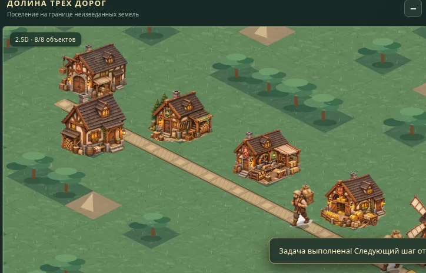

# Земли и эпохи · Lands & Ages

**Экономико-цивилизационная стратегия, рабочий прототип 0.4.2.**

Самостоятельная браузерная игра с изометрической графикой 2.5D. Игрок восстанавливает поселение, развивает производственные цепочки и выбирает один из пяти путей развития: экономика, наука, культура, дипломатия или оборона.



> **Статус:** ранний игровой прототип. Поддерживаются ПК и сенсорное управление браузера. Тесты в Chromium пройдены; реальный Android и стабильные 60 FPS пока **не подтверждены**. Имя игры рабочее.

## Запуск

- **Быстро и без интернета:** скачайте игровой HTML из артефактов успешного запуска [GitHub Actions](https://github.com/cyrox007/lands-and-ages/actions) или выполните `python build_standalone.py`, затем откройте полученный `play.html`. CSS, JS и восемь изображений включены в этот файл.
- **Для разработки:** откройте папку через локальный статический сервер, например `python -m http.server 8000`, затем http://localhost:8000/. Установки JavaScript-библиотек не требуется.
- **Пересборка автономной версии:** `python build_standalone.py`.

## Основные механики 0.4.2

- Дороги обязательны для грузоперевозок; товары транспортируются носильщиками, а не телепортируются.
- Производственные цепочки: брёвна → доски; зерно → мука → хлеб, с использованием топлива.
- Строительство по этапам: заказ → доставка досок → работа строителей → завершённый объект.
- Строящиеся дороги не проходимы; здания не производят до окончания строительства.
- Жители, питание, казна, налоги и довольство.
- Обучающая миссия «Испытание долины» и пять ранних направлений развития; победа и свободная игра.
- Изометрическая карта, восемь авторских 2.5D-спрайтов, жесты перемещения, сохранение в localStorage.

## Визуальная итерация 0.4.2

Детерминированные фактурные тайлы и кэш, геометрически корректные изометрические дороги, отдельный анимируемый строитель, направленное движение носильщика, стадии строительства на основе реальных ресурсов и работы, условный дым работающей пекарни. Подробности и текущие ограничения: [визуальный срез 0.4.2](docs/VISUAL-0.4.2.md). Это **промежуточная техническая итерация**, полноценные покадровые персонажи и качественный арт-пак ещё не завершены.

## Проверки

```sh
npm run check
# Опционально: браузерные smoke и полное прохождение миссии
pip install playwright
python -m playwright install chromium
python tests/browser_smoke.py
```

Проверка выполняется автоматически в GitHub Actions при push и PR. Браузерные тесты содержат эмуляцию локального хранилища и **не равны** проверкам на физическом Android.

## Организация репозитория

- `engine.js` — логика экономики, логистики, стройплощадок, миссии, сохранений.
- `ui.js`, `index.html`, `style.css` — управление и изометрический рендер.
- `assets/*.webp` — оптимизированные прозрачные игровые спрайты.
- `play.html` — автономная сборка, создаваемая скриптом и публикуемая как артефакт CI (не хранится в Git).
- `tests/` — тесты симуляции и браузера.
- `docs/ROADMAP.md`, `docs/ANDROID-QA.md` — разработка и проверка на устройстве.

## Ограничения и лор

Это ранняя **неполная** стратегия: нельзя пока управлять государствами на глобальной карте, в ней нет полноценной дипломатии, армий, рынков и технологий. Стройке пока нужны только доски и монеты; здания логически занимают одну клетку.

Игра может содержать фоновое окружение общей авторской вселенной, но **закрытый канон** не переносится в этот репозиторий. Он хранится отдельно в приватном `Story-s`. В игре нет прямых хроник о «небесной войне» или раскрытия тайны Феникса.

**Авторский проект.** Лицензия на распространение и переиспользование исходников пока не определена; отдельный `LICENSE` намеренно не добавлялся.
